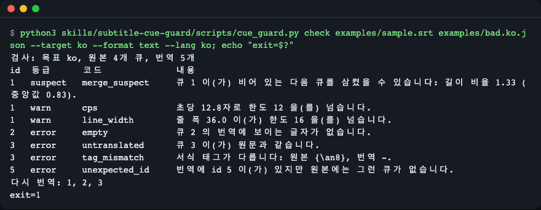
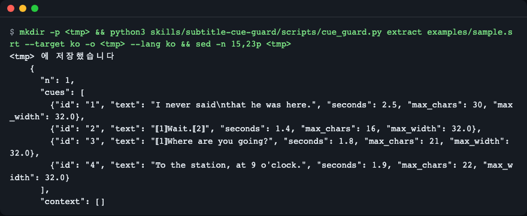
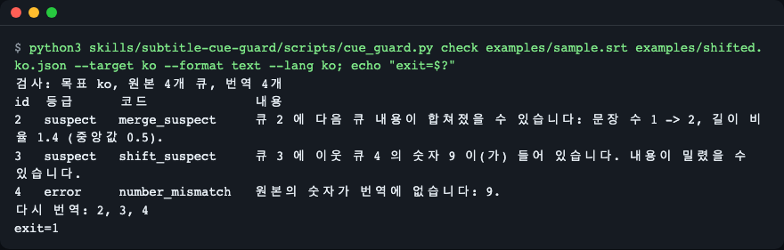
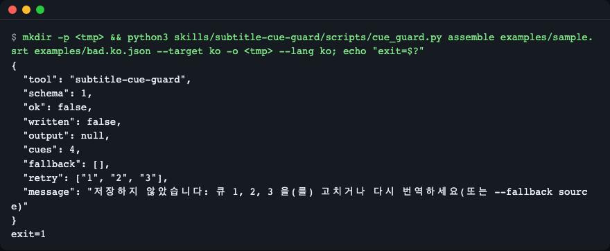
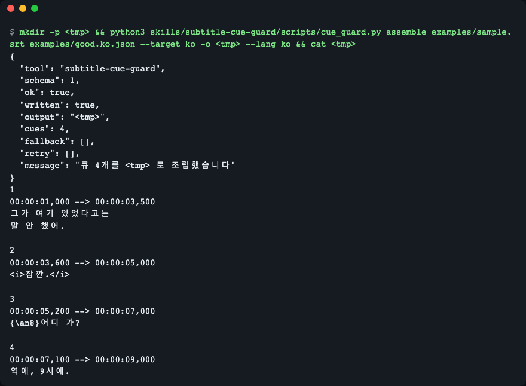
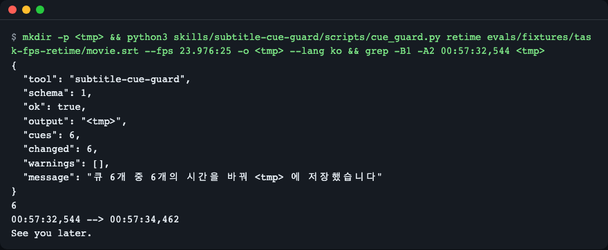
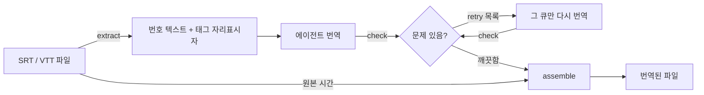

# subtitle-cue-guard

[English](README.md) | **한국어**

AI 에이전트가 SRT·WebVTT 자막을 번역할 때 큐(자막 한 덩어리)가 어긋나지 않게 지켜 주는 에이전트 스킬입니다. 함께 들어 있는 Python 스크립트(표준 라이브러리만 사용)가 시간 코드와 태그를 모델 손에 맡기지 않고, 번역을 원본과 대조해, 다시 번역할 큐 ID 만 정확히 알려 줍니다.


*`check` 는 번역을 원본과 비교하고, 마지막 줄에 다시 번역할 큐 ID 목록을 줍니다.*

## 무엇을 하나

- **시간 코드는 모델을 거치지 않습니다.** `extract` 는 번호 붙은 텍스트만 모델에 주고, `assemble` 은 번역을 원본 파일에 다시 끼워 넣습니다. 번역이 없으면 파일이 바이트까지 같습니다(BOM·CRLF·큐 설정 포함).
- **구조를 결정적으로 검사합니다.** 빠진·예상 밖·빈·미번역 큐, 사라지거나 바뀐 서식 태그, 빠진 숫자, 이웃 큐로 밀린 내용, 두 큐가 하나로 합쳐진 경우, 읽기 속도와 줄 폭(CJK 폭 반영).
- **실패한 것만 다시 합니다.** `retry` 목록이 다시 번역할 큐 ID 를 알려 주고, 이웃 큐는 읽기 전용 문맥으로 붙습니다. 깨진 번역이면 `assemble` 이 파일을 쓰지 않습니다.
- **시간 보정도 합니다.** 프레임레이트 변환(`23.976:25`), 시간 이동, 최소 표시 시간·간격.

번역이 자연스러운지는 판단하지 않습니다. `suspect` 는 증거가 아니라 의심입니다. ASS/SSA 파일은 지원하지 않습니다.

## 설치

**Claude Code**

```
/plugin marketplace add LeeGyeongPil/subtitle-cue-guard
/plugin install subtitle-cue-guard@subtitle-cue-guard-skill
```

**Codex CLI 와 Agent Skills 표준을 읽는 다른 에이전트** — `skills/subtitle-cue-guard` 폴더를 에이전트의 스킬 폴더(Codex 는 프로젝트의 `.agents/skills/`)에 복사합니다.

필요한 것: Python 3.10 이상(`python3 --version`). 패키지도 네트워크도 필요 없습니다. 개발용 테스트를 돌리려면 [uv](https://docs.astral.sh/uv/)도 필요합니다(`curl -LsSf https://astral.sh/uv/install.sh | sh`). 에이전트 없이 쓰려면 레포를 받아 아래 예시처럼 스크립트를 직접 실행합니다.

```
git clone https://github.com/LeeGyeongPil/subtitle-cue-guard
cd subtitle-cue-guard
```

## 사용법

에이전트에게 평소 말투로 요청하면 됩니다. 이 스킬이 겨냥한 요청은 이런 것들입니다.

- "이 .srt 한국어로 번역해 줘." (영어로: "Translate this .srt into Korean.")
- "번역한 자막이 밀렸어, 고쳐 줘." (영어로: "I translated my subtitles but they drifted out of sync.")
- "23.976 자막을 25fps 영상에 맞춰 줘." (영어로: "Convert this 23.976 fps subtitle file to 25 fps.")

에이전트가 스크립트를 대신 실행합니다. 단계를 직접 해 볼 수도 있습니다. `examples/` 의 파일은 연습용입니다. `bad.ko.json` 과 `shifted.ko.json` 은 실패 사례를 손으로 재현한 것이고 실제 모델 출력이 아닙니다.

### 1. 번역할 텍스트 뽑기

```
python3 skills/subtitle-cue-guard/scripts/cue_guard.py extract examples/sample.srt --target ko -o batch.json
```


*모델은 `id`, `text`, 글자 예산만 봅니다. `<i>`·`{\an8}` 같은 태그는 `⟦n⟧` 자리표시자로 나오고 시간 코드는 없습니다.*

### 2. 번역 검사하기

에이전트는 `{"<id>": "<번역>"}` 을 씁니다. 아래는 일부러 깨뜨린 연습용 번역입니다.

```
python3 skills/subtitle-cue-guard/scripts/cue_guard.py check examples/sample.srt examples/bad.ko.json --target ko --format text
```

출력은 맨 위 스크린샷과 같습니다. 종료 코드 0 은 문제 없음, 1 은 `retry` 목록의 큐를 다시 번역, 2 는 입력을 읽을 수 없음입니다.

큐 ID 가 전부 있어도 텍스트가 엉뚱한 큐에 들어갈 수 있습니다. 두 번째 사례입니다.

```
python3 skills/subtitle-cue-guard/scripts/cue_guard.py check examples/sample.srt examples/shifted.ko.json --target ko --format text
```


*숫자·문장 수·길이 비율이 닻 역할을 합니다. 큐 3 에 큐 4 의 "9" 가 있어 큐 2, 3, 4 를 다시 번역합니다.*

### 3. 실패한 큐만 다시 번역하기

```
python3 skills/subtitle-cue-guard/scripts/cue_guard.py check examples/sample.srt examples/bad.ko.json --target ko -o report.json
python3 skills/subtitle-cue-guard/scripts/cue_guard.py extract examples/sample.srt --target ko --retry-from report.json --context 1 -o retry1.json
```

`retry1.json` 에는 번역할 큐 1·2·3 과 읽기 전용 `context` 인 큐 4 가 들어 있습니다. 에이전트가 `tr.retry1.json` 을 저장하면 `check SRC tr.json tr.retry1.json` 으로 다시 검사합니다(뒤 파일이 앞 파일을 덮어씀). 스킬은 최대 2회전까지만 허용합니다.

### 4. 조립하기

```
python3 skills/subtitle-cue-guard/scripts/cue_guard.py assemble examples/sample.srt examples/bad.ko.json --target ko -o out.srt
```


*오류나 의심이 남아 있으면 아무것도 쓰지 않고 종료 코드 1 을 냅니다. 2회전 뒤에는 `--fallback source` 로 실패한 큐만 원문을 유지할 수 있습니다.*

번역이 깨끗하면 원래 시간 위에 파일이 만들어집니다.

```
python3 skills/subtitle-cue-guard/scripts/cue_guard.py assemble examples/sample.srt examples/good.ko.json --target ko -o out.srt
```


*시간 코드, `<i>` 태그, `{\an8}` 위치 태그가 원본과 똑같습니다.*

### 5. 시간 보정

```
python3 skills/subtitle-cue-guard/scripts/cue_guard.py retime evals/fixtures/task-fps-retime/movie.srt --fps 23.976:25 -o retimed.srt
grep -B1 -A2 00:57:32,544 retimed.srt
```


*보고서는 큐 6개 중 6개 변경을 알리고, `grep` 은 변환 후 `00:57:32,544` 큐를 보여 줍니다: 결과는 모델이 아니라 스크립트가 계산합니다.*

다른 옵션: `--shift=+1.5s`(음수는 등호로 `--shift=-2s`), `--min-duration 0.83 --min-gap 0.083`, `assemble --bilingual`, `assemble --renumber`.

### 화면 언어

출력은 영어 또는 한국어입니다. `--lang en|ko` > `SUBTITLE_CUE_GUARD_LANG` > `LC_ALL`/`LC_MESSAGES`/`LANG`(`ko` 로 시작하면 한국어, 아니면 영어). 바뀌는 것은 `message` 문장뿐이고 코드·JSON 키는 같습니다. argparse 의 `usage`/`options` 제목은 영어로 고정입니다.

### 설정

`check` 는 `ko`·`en` 에 Netflix 기준 한도(초당 글자 수, 줄 폭, 줄 수)를 적용합니다. 다른 언어는 문자 체계나 원문 동일 여부만 검사하며, `--cps N --line-width N --max-lines N` 또는 `--profile file.json` 으로 한도를 줄 수 있습니다. `--no-retry-readability` 는 읽기 속도 수치는 남기되 다시 번역 목록에서는 뺍니다. 자세한 내용은 `skills/subtitle-cue-guard/references/` 에 있습니다.

| 언어 | 초당 글자 수 | 줄당 글자 수 | 줄 수 | 출처 |
|---|---|---|---|---|
| `ko` | 12 (공백 제외) | 16 | 2 | [Netflix Korean Timed Text Style Guide](https://partnerhelp.netflixstudios.com/hc/en-us/articles/216001127) |
| `en` | 20 (공백 포함) | 42 | 2 | [Netflix English (USA) Timed Text Style Guide](https://partnerhelp.netflixstudios.com/hc/en-us/articles/217350977-English-USA-Timed-Text-Style-Guide) |

값은 2026-11-21 에 확인했습니다. 엄격한 시작값으로 보고, 의뢰처가 다르게 정하면 바꿔 쓰세요.

### 이슈 코드

| 코드 | 등급 | `retry` 포함 |
|---|---|---|
| `missing`, `empty`, `untranslated`, `tag_mismatch`, `number_mismatch` | error | 예 |
| `unexpected_id` | error | 아니오 (ID 를 확인) |
| `shift_suspect`, `merge_suspect` | suspect | 해당 큐와 이웃 큐 |
| `cps`, `too_many_lines`, `line_width` | warn | 예 (`--no-retry-readability` 면 제외) |
| `overlap`, `out_of_order`, `nonpositive_duration`, `stray_block` | source | 아니오 (원본에 이미 있음) |

각 뜻: `skills/subtitle-cue-guard/references/issue-codes.md`.

## 검증된 동작

<!-- skill-eval:start -->
| 확인 | 결과 |
|---|---|
| 필요할 때 불림 | 13/13 |
| 필요 없을 때 안 불림 | 12/12 |
| 스킬로 푼 작업 | 6/6 |
| 스킬 없이 푼 작업(기준선) | 2/6 |
| 평균 점수 차이(Δ) | +0.51 |
| 가짜 스크립트를 잡아낸 비율 | 5/6 |
| Codex CLI | 작업 6/6 통과 · 확인됨 |

Claude Code 2.1.322 · sonnet · 케이스마다 3회 · 2026-11-22 측정 · codex-cli 0.154.0
<!-- skill-eval:end -->

## 동작 원리



1. `extract` 가 파일을 읽어 큐를 파일 순서로 번호 매기고 태그를 자리표시자로 바꿉니다.
2. 에이전트가 텍스트를 번역합니다. 시간 코드는 보지도 쓰지도 않습니다.
3. `check` 가 번역을 원본과 비교해 다시 할 큐 ID 를 출력합니다.
4. 그 큐만 이웃 큐를 문맥으로 두고 다시 번역합니다.
5. `assemble` 이 원본 파일에서 각 큐의 텍스트 줄만 바꿔 넣습니다.

스크립트는 지정한 파일만 읽고 `-o` 경로에만 씁니다. 네트워크도 패키지도 쓰지 않습니다. `SKILL.md` 는 에이전트에게 언제 호출할지 알려 주고, 계산은 스크립트가 합니다.

## 언제 쓰나

에이전트가 자막 파일을 번역하거나 고칠 때, 구조를 눈대중이 아니라 보장으로 지키고 싶다면 맞습니다. 큐 하나가 밀려 뒤쪽 싱크가 전부 틀어지는 긴 파일에 특히 그렇습니다.

음성 인식([Whisper](https://github.com/openai/whisper) 같은 전사 도구), 번역 문장이 자연스러운지 판단, ASS/SSA 스타일 작업에는 맞지 않습니다. 일반적인 자막 편집·형식 변환은 [pysubs2](https://github.com/tkarabela/pysubs2) 나 [Subtitle Edit](https://github.com/SubtitleEdit/subtitleedit) 를 보세요.

## 개발

```
uv sync && uv run pytest -q
```

`evals/` 에는 발동해야 하는·하지 말아야 하는 trigger 케이스와 채점기·픽스처가 있는 작업 케이스 6개가 있습니다. `tests/test_evals_manifest.py` 가 모든 채점 규칙이 실제 스크립트 출력에 맞는지 확인합니다.

## 라이선스

MIT
