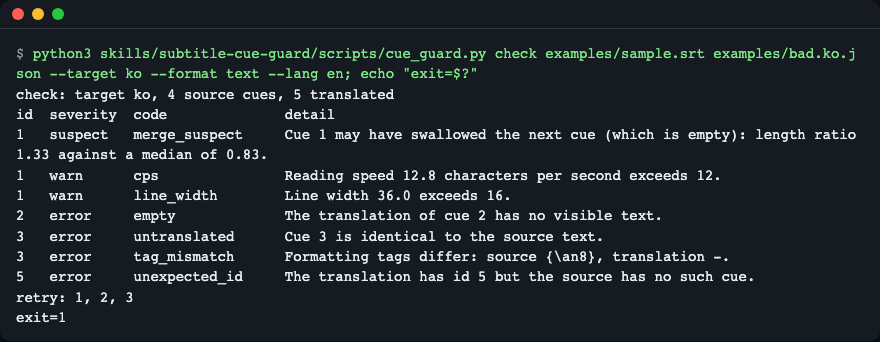
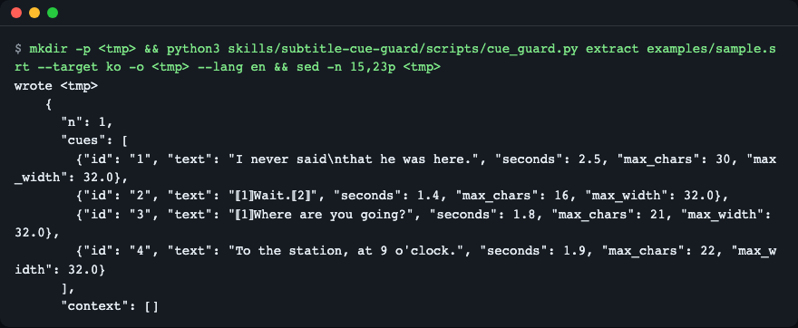
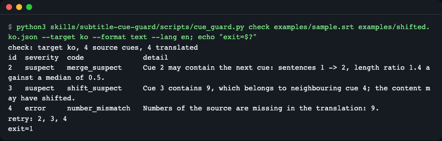
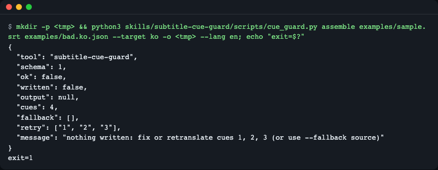
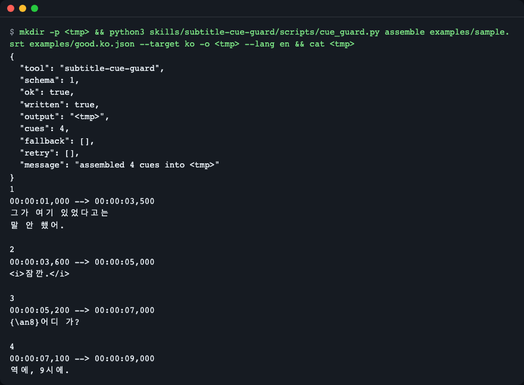
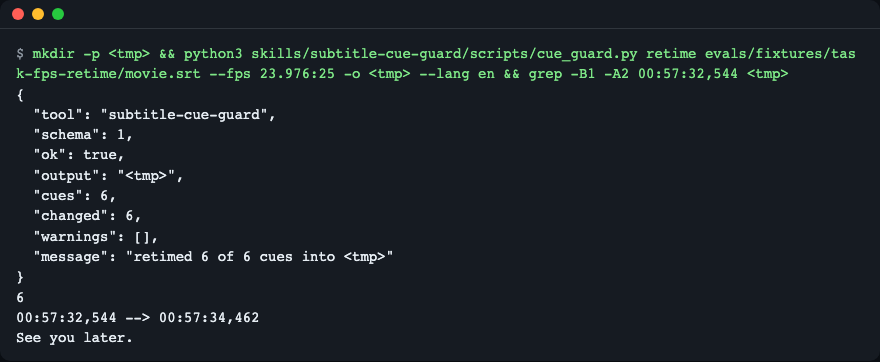
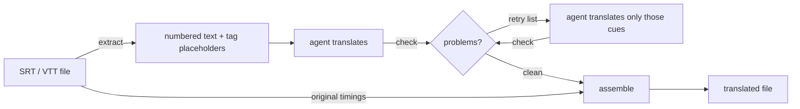

# subtitle-cue-guard

**English** | [한국어](README.ko.md)

An agent skill that translates SRT and WebVTT subtitles with your AI agent without breaking the cues. A bundled Python script (standard library only) keeps time codes and tags out of the model's hands, checks every translation against the source, and tells the agent exactly which cue IDs to translate again.


*`check` compares a translation with its source and ends with the list of cue IDs to redo.*

## What it does

- **Time codes never go through the model.** `extract` hands the model only numbered text; `assemble` puts the translation back into the original file, so an untouched file stays identical byte for byte (BOM, CRLF and cue settings included).
- **Checks the structure deterministically.** Missing, unexpected, empty and untranslated cues, lost or changed formatting tags, missing numbers, content that slid into the neighbouring cue, two cues merged into one, reading speed and line width (CJK-aware).
- **Retries only what failed.** The `retry` list names the cue IDs to translate again, with the neighbouring cues as read-only context. `assemble` refuses to write a broken file.
- **Also retimes.** Frame-rate conversion (`23.976:25`), shifting, minimum duration and gap.

It does not judge translation quality. A `suspect` finding is a guess, not proof. ASS/SSA files are not supported.

## Install

**Claude Code**

```
/plugin marketplace add LeeGyeongPil/subtitle-cue-guard
/plugin install subtitle-cue-guard@subtitle-cue-guard-skill
```

**Other agents that read the Agent Skills standard** — copy `skills/subtitle-cue-guard` into the agent's skills folder. Only Claude Code is verified (see the table below).

Requirements: Python 3.10 or newer (`python3 --version`). No packages, no network access. To run the development tests you also need [pytest](https://docs.pytest.org/) (`uv sync` installs it; install uv with `curl -LsSf https://astral.sh/uv/install.sh | sh`). Without agent: clone the repository and call the script directly, as in the examples below.

```
git clone https://github.com/LeeGyeongPil/subtitle-cue-guard
cd subtitle-cue-guard
```

## Use it

Ask your agent in plain language. These requests are the kind the skill is written for:

- "Translate this .srt into Korean."
- "I translated my subtitles but they drifted out of sync, can you fix them?"
- "Convert this 23.976 fps subtitle file to 25 fps."

The agent runs the script for you. You can also run each step yourself. The files in `examples/` are practice material: `bad.ko.json` and `shifted.ko.json` are failures reproduced by hand, not real model output.

### 1. Extract the text to translate

```
python3 skills/subtitle-cue-guard/scripts/cue_guard.py extract examples/sample.srt --target ko -o batch.json
```


*The model sees `id`, `text` and a character budget. Tags such as `<i>` and `{\an8}` appear as `⟦n⟧` placeholders and there are no time codes.*

### 2. Check a translation

The agent writes `{"<id>": "<translation>"}`. Here is a broken practice translation:

```
python3 skills/subtitle-cue-guard/scripts/cue_guard.py check examples/sample.srt examples/bad.ko.json --target ko --format text
```

The output is the first screenshot above. Exit code 0 means no problem, 1 means the `retry` list names cues to redo, 2 means the input could not be read.

The command above prints in your language; the screenshots were taken with `--lang en`, so add `--lang en` to see identical text.

Every cue ID can be present and the text can still be in the wrong cue. This is the second case:

```
python3 skills/subtitle-cue-guard/scripts/cue_guard.py check examples/sample.srt examples/shifted.ko.json --target ko --format text
```


*Numbers, sentence counts and length ratios act as anchors: cue 3 holds the "9" of cue 4, so cues 2, 3 and 4 are retried.*

### 3. Retranslate only the failing cues

```
python3 skills/subtitle-cue-guard/scripts/cue_guard.py check examples/sample.srt examples/bad.ko.json --target ko -o report.json
python3 skills/subtitle-cue-guard/scripts/cue_guard.py extract examples/sample.srt --target ko --retry-from report.json --context 1 -o retry1.json
```

`retry1.json` holds cues 1, 2 and 3 to translate, and cue 4 as read-only `context`. After the agent saves `tr.retry1.json`, check again with `check SRC tr.json tr.retry1.json` (later files overwrite earlier ones). The skill allows at most two rounds. An `unexpected_id` error is not in the retry list and later files cannot remove an id, so delete that id from `tr.json` yourself before checking again.

### 4. Assemble

```
python3 skills/subtitle-cue-guard/scripts/cue_guard.py assemble examples/sample.srt examples/bad.ko.json --target ko -o out.srt
```


*With errors or suspects left, nothing is written and the exit code is 1. `--fallback source` keeps the original text for failing cues after the second round.*

With a clean translation the file is written onto the original timings:

```
python3 skills/subtitle-cue-guard/scripts/cue_guard.py assemble examples/sample.srt examples/good.ko.json --target ko -o out.srt
```


*The time codes, the `<i>` tags and the `{\an8}` position tag are exactly those of the source.*

### 5. Retime

```
python3 skills/subtitle-cue-guard/scripts/cue_guard.py retime evals/fixtures/task-fps-retime/movie.srt --fps 23.976:25 -o retimed.srt
grep -B1 -A2 00:57:32,544 retimed.srt
```


*The report says 6 cues, 6 changed; `grep` shows the cue at `00:57:32,544` after conversion: the result is computed by the script, not by the model.*

Other options: `--shift=+1.5s` (write negatives with an equals sign, `--shift=-2s`), `--min-duration 0.83 --min-gap 0.083`, `assemble --bilingual`, `assemble --renumber`.

### Screen language

Output is in English or Korean: `--lang en|ko`, else `SUBTITLE_CUE_GUARD_LANG`, else `LC_ALL`/`LC_MESSAGES`/`LANG` (Korean if it starts with `ko`, otherwise English). Only the `message` texts change; codes and JSON keys stay the same. The argparse `usage`/`options` headings stay in English.

### Settings

`check` applies Netflix-based limits for `ko` and `en` (characters per second, line width, number of lines). For other languages the script checks only the script or identity, unless you pass `--cps N --line-width N --max-lines N` or `--profile file.json`. `--no-retry-readability` keeps the reading-speed numbers but removes them from the retry list. Details are in `skills/subtitle-cue-guard/references/`.

| Language | Characters per second | Characters per line | Lines | Source |
|---|---|---|---|---|
| `ko` | 12 (spaces not counted) | 16 | 2 | [Netflix Korean Timed Text Style Guide](https://partnerhelp.netflixstudios.com/hc/en-us/articles/216001127) |
| `en` | 20 (spaces counted) | 42 | 2 | [Netflix English (USA) Timed Text Style Guide](https://partnerhelp.netflixstudios.com/hc/en-us/articles/217350977-English-USA-Timed-Text-Style-Guide) |

Values confirmed 2026-11-21. Treat them as a strict starting point and override them when your client says otherwise.

### Issue codes

| Code | Level | In `retry` |
|---|---|---|
| `missing`, `empty`, `untranslated`, `tag_mismatch`, `number_mismatch` | error | yes |
| `unexpected_id` | error | no (check the ids) |
| `shift_suspect`, `merge_suspect` | suspect | the cue and its neighbour |
| `cps`, `too_many_lines`, `line_width` | warn | yes (unless `--no-retry-readability`) |
| `overlap`, `out_of_order`, `nonpositive_duration`, `stray_block` | source | no (already in the source file) |

Meanings: `skills/subtitle-cue-guard/references/issue-codes.md`.

## Verified behavior

<!-- skill-eval:start -->
| Check | Result |
|---|---|
| Triggers when it should | 13/13 |
| Stays quiet when it should not | 12/12 |
| Tasks solved with the skill | 6/6 |
| Tasks solved without it (baseline) | 2/6 |
| Mean score gain (Δ) | +0.47 |
| Tasks that catch a broken script | 5/6 |
| Codex CLI | not verified |

Measured 2026-11-23 with Claude Code 2.1.322 · sonnet · 3 runs per case · codex-cli 0.154.0
<!-- skill-eval:end -->

## How it works



1. `extract` reads the file, numbers the cues in file order and turns tags into placeholders.
2. The agent translates the text. It never sees or writes a time code.
3. `check` compares the translation with the source and prints the cue IDs to redo.
4. Only those cues are translated again, with neighbours as context.
5. `assemble` replaces just the text lines of each cue in the original file.

The script reads the files you name and writes only the `-o` path. It uses no network and no packages. `SKILL.md` tells the agent when to call it; the script does the counting.

## When to use it

Use it when an agent translates or repairs subtitle files and you want the structure guaranteed rather than eyeballed. It fits long files where one slipped cue ruins the sync for the rest.

It is the wrong tool for speech-to-text (use a transcription tool such as [Whisper](https://github.com/openai/whisper)), for judging how good a translation reads, or for ASS/SSA styling. For general subtitle editing and format conversion, look at [pysubs2](https://github.com/tkarabela/pysubs2) or [Subtitle Edit](https://github.com/SubtitleEdit/subtitleedit).

## Development

```
uv sync && uv run pytest -q   # CI installs pytest with pip instead
```

`evals/` holds trigger cases (should and should not start the skill) and six task cases with graders and fixtures; `tests/test_evals_manifest.py` checks that every grader matches the real script output. The only dev dependency is pytest. CI (`.github/workflows/ci.yml`) runs these tests on Python 3.10 and 3.14 with pytest installed from pip. `.gitattributes` checks ordinary text files out with LF, and marks `*.srt`, `*.vtt` and the fixture folders `-text` so Git never converts their bytes (CRLF, BOM, missing final newline stay as written) on any OS checkout, and `tests/test_ci_robustness.py` guards that setup.

## License

MIT
